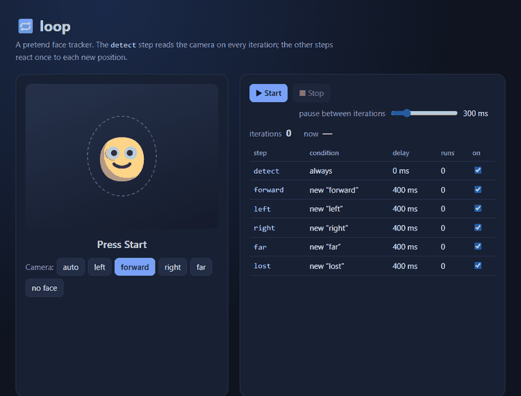

<div align="center">

# 🔁 loop

**A tiny async scheduler that runs a list of steps over and over.**

Each step has its own condition, delay and store. All steps share a common
store and a context to talk to each other. No dependencies, browsers and Node.

[](https://github.com/mredwardlik/loop/actions/workflows/tests.yml)


[](LICENSE)



</div>

---

## 💡 Idea

Some logic is easiest to write as a **polling loop**: check a sensor, react
when something changes, wait, repeat. Camera and face-tracking flows, kiosk
screens and simple game loops are like that. `loop` turns it into a
declarative list of steps:

```text
┌──────────── iteration ────────────┐
│  step 1 → step 2 → … → step N     │ ── wait `delay` ──┐
└───────────────────────────────────┘                   │
              ▲                                         │
              └─────────────────────────────────────────┘
```

On every iteration each step, in order:

1. is skipped if it is turned off or its `condition(ctx)` returns `false`
2. waits for its own `delay`
3. runs its `body(ctx)`, sync or `async`, and keeps what it returns

## 🚀 Installation

```bash
npm install github:mredwardlik/loop
```

```js
import Loop from 'loop'
```

Or copy [`src/loop.js`](src/loop.js) into your project: it is one file
without dependencies. Types are in [`src/loop.d.ts`](src/loop.d.ts).

## ✍️ Example

```js
import Loop from 'loop'

const loop = new Loop({
  delay: 500, // pause between iterations, ms
  store: { position: null, handled: true },
  steps: [
    {
      name: 'detect',
      body: async (ctx) => {
        const store = ctx.store()
        const position = await camera.getHeadPosition() // 'left' | 'right' | ...
        if (position !== store.position) {
          store.position = position
          store.handled = false
        }
      },
    },
    {
      name: 'left',
      delay: 1000,
      // runs once for each new "left" detection
      condition: (ctx) => {
        const store = ctx.store()
        if (store.position !== ctx.current().name || store.handled) return false
        store.handled = true
        return true
      },
      body: (ctx) => {
        say('Turn your head back')
        if (ctx.iterations('left') >= 2) ctx.stop() // the third time, stop the whole loop
      },
    },
  ],
})

const iterations = await loop.start() // resolves once the loop is stopped
```

## 📖 API

### `new Loop(config)`

| Option    | Type                  | Default    | Description                                        |
| --------- | --------------------- | ---------- | -------------------------------------------------- |
| `delay`   | `number`              | `1000`     | pause between iterations, ms                       |
| `steps`   | `Step[]`              | `[]`       | the steps, run in this order (`methods` works too) |
| `store`   | `object`              | `{}`       | the store shared by all steps                      |
| `limit`   | `number`              | `Infinity` | stop after this many iterations                    |
| `onError` | `(error, ctx) => void`| —          | called when a step throws; the loop goes on        |

Without `onError`, an error in a step stops the loop and rejects `start()`.

**Step**

| Field       | Type                        | Default      | Description                                  |
| ----------- | --------------------------- | ------------ | -------------------------------------------- |
| `name`      | `string`                    | required     | unique name                                  |
| `body`      | `(ctx) => any \| Promise`   | required     | the work, sync or `async`                    |
| `condition` | `(ctx) => boolean \| Promise` | `() => true` | the step runs only when this returns `true` |
| `delay`     | `number`                    | `0`          | pause before the body runs, ms               |
| `store`     | `object`                    | `{}`         | the step's own store                         |
| `enabled`   | `boolean`                   | `true`       | start with the step turned off               |

**Loop**

| Member                 | Description                                                         |
| ---------------------- | ------------------------------------------------------------------- |
| `start()`              | runs the loop; resolves with the number of iterations once it stops. Calling it again while running returns the same promise; after a stop it starts again |
| `stop()`               | stops after the step that is running now. Pauses end at once (`stopLoop()` is the old name) |
| `enable(name)`, `disable(name)` | turn a step on or off                                      |
| `step(name)`, `steps`  | a step and all steps: `name`, `iterations`, `result`, `enabled`, `store` |
| `iterations`, `current`, `running`, `stopped` | the state of the loop                       |
| `delay`                | can be changed while the loop runs                                  |

### Context

Every `body` and `condition` gets a `ctx`:

| Method              | Description                                                        |
| ------------------- | ------------------------------------------------------------------ |
| `store(name?)`      | the common store, or the store of step `name`                      |
| `current()`         | the step that is being checked or run now                          |
| `result(name)`      | what step `name` returned the last time                            |
| `iterations(name?)` | finished iterations, or how many times step `name` has run         |
| `steps()`           | all steps                                                          |
| `stop(name?)`       | stop the whole loop, or turn off only step `name`                  |
| `resume(name)`      | turn step `name` on again                                          |
| `delay(ms)`         | `await ctx.delay(300)` pauses inside a step; `stop()` cuts it short |

A step name that does not exist throws an error instead of returning
`undefined`, so typos are found at once.

> [!NOTE]
> The pause between iterations always goes through a timer, even with
> `delay: 0`. A loop whose steps have nothing to do never blocks the page.

## 🧪 Demo

[`demo/`](demo) is a pretend face tracker: a `detect` step reads a fake
camera on every iteration, and a step for each position reacts once to every
new position. Steps can be turned off, the pause changed on the fly, and the
camera position picked by hand.

```bash
git clone https://github.com/mredwardlik/loop.git
cd loop
npm run demo        # http://localhost:8000/demo/
```

## ✅ Tests

```bash
npm test            # node --test, no packages to install
```

GitHub Actions runs them on Node 20, 22 and 24.

## 📄 License

[MIT](LICENSE) © Edward Lik
